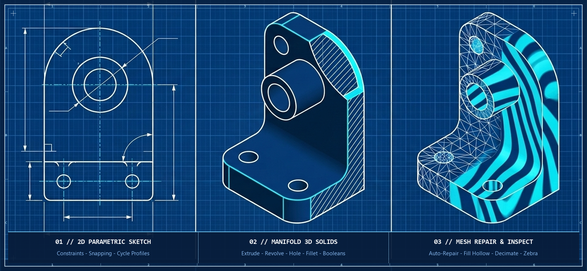

<p align="center">
  
</p>

<h1 align="center">onlineCAD</h1>

<p align="center">
  <strong>Zero-install, client-side 3D CAD modeling in modern web browsers.</strong><br/>
  Parametric 2D sketching, Manifold WebAssembly solid modeling, STL mesh repair, and real-time WebGL2 shading with zero server dependencies.
</p>

<p align="center">
  <a href="https://cad.borakosalay.me"><strong>Launch Live App (cad.borakosalay.me)</strong></a>
  &nbsp;-&nbsp;
  <a href="#capabilities">Capabilities</a>
  &nbsp;-&nbsp;
  <a href="#architecture">Architecture</a>
  &nbsp;-&nbsp;
  <a href="#getting-started">Quick Start</a>
  &nbsp;-&nbsp;
  <a href="#keyboard-shortcuts">Shortcuts</a>
  &nbsp;-&nbsp;
  <a href="#testing">Testing</a>
</p>

---

## Workspace Overview

**onlineCAD** brings mechanical 2D sketching, Constructive Solid Geometry (CSG) solid modeling, and heavy STL/mesh preparation into a fast, zero-build browser workspace. Every boolean operation, voxel fill, mesh repair, and studio shading pass executes locally on the user's machine via WebAssembly, Web Workers, and WebGL2.

<p align="center">
  
</p>

- **Clean Studio Interface**: Tabbed `SOLID`, `MESH`, `UTILITIES`, and `SKETCH` workspaces with crisp 24x24 geometric CAD iconography, ViewCube camera navigation, and an integrated Browser tree.
- **Movable Floating Tool Dialogs**: Every modeling, mesh, and inspection palette (Extrude, Revolve, Fillet/Chamfer, Hole, Move/Rotate, Pattern, Mesh tools, Zebra, Interference) can be freely dragged across the viewport, clamped automatically on resize, and reset with a double-click.
- **Cursor Tool Search (`S`)**: Fuzzy command palette positioned right next to your cursor for instant keyboard-first tool launching.

---

## Capabilities

<p align="center">
  
</p>

### 1. Constraint-Driven 2D Sketching
- **Planes & Planar Faces**: Sketch directly on Cartesian planes (`XY`, `XZ`, `YZ`) or onto any planar face of an existing 3D solid body.
- **Drawing & Editing**: Lines, 2-point rectangles, center circles, points, construction geometry (`X`), dynamic Trim (`T`), corner and curve-curve Fillet (`F`), Offset (`O`), Mirror, and Circular/Rectangular Patterns.
- **Constraints & Magnetic Snapping**: Coincident, Horizontal/Vertical (`H`), Tangent (`G`), Equal, Midpoint, and Fix constraints with live dimensional HUD inputs (`Tab` to lock values) and a right-click shortcut wheel.
- **Cycle Profile Solver**: Automatic closed-loop and nested island detection for clean multi-region solid extrusions and revolutions.

### 2. Solid 3D Modeling (Manifold WASM)
- **Extrude (`E`)**: Solid and thin-wall extrusions supporting `New Body`, `Join`, `Cut`, and `Intersect` operations across one-sided, two-sided, and symmetric extents with auto-cut overlap detection and interactive 3D arrow dragging.
- **Revolve (`V`)**: Partial (`1` to `360` deg) and full revolutions around `X`, `Y`, or any picked sketch line axis with live boolean integration.
- **3D Hole (`H`)**: Interactive face-placed Simple, Counterbore, and Countersink holes with Through-All or Blind depth controls and live 3D HUD editing.
- **Fillet (`F`) & Chamfer**: Constant-radius rounding and 45-degree beveling across straight solid edges and continuous circular rims.
- **Move / Rotate (`M`) & Patterns**: 3D translation and rotation gizmo with custom pivot selection, center-and-ground (`Z = 0`), Copy mode, and Rectangular/Circular body arrays.

### 3. Mesh Repair, Simplification & Diagnostics
- **Automatic Mesh Repair**: Non-manifold edges, stray degenerate facets, inconsistent winding, and small boundary holes in imported STL files are automatically repaired before boolean and solid conversion operations.
- **Mesh to Solid**: Reconstructs analytic primitives (planes, cylinders, holes, spheres) or adapts watertight meshes into editable solid bodies.
- **Fill Hollow**: Converts hollow shells into solid bodies. Fully enclosed cavities are filled cleanly at the shell level; shells open through vents or windows are bridged via a worker-backed voxel flood fill while preserving the outer skin.
- **Decimate & CAD Surface Finish**: Worker-accelerated spatial clustering mesh simplification for viewport display and crease-angle smoothing (`42` deg default or custom) without altering source export geometry.
- **Inspection Tools**: Orthogonal Horizontal/Vertical Zebra curvature reflection shaders, 3D multi-body Interference volume clash detection, and Show Mesh wireframe overlay.

### 4. Timeline History, Autosave & Interoperability
- **Interactive Feature Timeline**: Step-by-step undo/redo history grouped into clean design features for visual inspection and one-click rollback (`Ctrl+Z` / `Ctrl+Y`).
- **Native Persistence & Crash Recovery**: Native `.ocad` project files plus automatic IndexedDB browser drafts (`FILE > Open Browser Draft`) with unsaved-changes warnings and crash recovery prompts.
- **Import & Export**: Drag-and-drop import for `STL`, `STEP` (`.step`, `.stp`), `OBJ`, and `DXF`; export to binary/ASCII `STL`, `3MF` (one object per body in millimetres for Bambu Studio, PrusaSlicer, Cura, and OrcaSlicer), `OBJ`, `.ocad`, and layered AutoCAD R12 `DXF`.

---

## Architecture

<p align="center">
  
</p>

| Layer | Technology | Role |
| :--- | :--- | :--- |
| **Solid Geometry Kernel** | [Manifold](https://github.com/elalish/manifold) (`manifold.wasm`) | Watertight CSG booleans, extrusions, revolutions, interference checks |
| **2D Sketch Engine** | Custom Vanilla JS (`js/sketch-*.js`) | Constraint relaxation, magnetic snapping, closed-loop profile solving |
| **Background Compute** | Dedicated Web Workers (`js/*-worker.js`) | Non-blocking STL parsing, mesh decimation, Fill Hollow, CAD surface normals |
| **3D Studio Renderer** | Custom WebGL2 + GLSL (`js/body-renderer.js`) | VBO-cached triangles, key/fill studio lighting, crease silhouettes, Zebra shaders |
| **Storage & Runtime** | IndexedDB + Native ES Modules | Zero build step, zero bundler overhead, offline-capable client persistence |

---

## Getting Started

### Prerequisites
A modern browser with WebGL2 and WebAssembly support (Chrome, Edge, Firefox, or Safari).

### Local Development
Because onlineCAD loads WebAssembly (`.wasm`) modules and Web Workers, serve the repository over a local HTTP server:

```bash
# 1. Clone the repository
git clone https://github.com/boraiks/onlineCAD.git
cd onlineCAD

# 2. (Optional) Enable the pre-commit build-stamp hook
git config core.hooksPath .githooks

# 3. Start a local static server
python -m http.server 8080
# Or with Node.js:
npx serve .
```

Open `http://localhost:8080` in your browser.

---

## Keyboard Shortcuts

| Shortcut | Action | Scope |
| :--- | :--- | :--- |
| `S` | Open Tool Search Palette | Global |
| `E` | Extrude | Solid Workspace |
| `V` | Revolve | Solid Workspace |
| `H` | 3D Hole | Solid Workspace |
| `M` | Move / Rotate | Solid / Mesh Workspace |
| `F` | 3D Fillet / Sketch Fillet | Solid / Sketch |
| `L` | Line (opens plane picker outside sketch) | Global / Sketch |
| `R` | 2-Point Rectangle (opens plane picker) | Global / Sketch |
| `C` | Circle (opens plane picker) | Global / Sketch |
| `T` | Trim | Sketch |
| `O` | Offset | Sketch |
| `D` / `A` | Distance / Angle Dimension | Sketch |
| `X` | Toggle Construction Geometry | Sketch |
| `Home` | Fit Scene to View | Viewport |
| `Delete` | Delete selected sketch entities or body | Sketch / Solid |
| `Ctrl+Z` / `Ctrl+Y` | Undo / Redo | Global |
| `Ctrl+S` / `Ctrl+O` | Save / Open `.ocad` Project | Global |
| `Escape` | Cancel active tool or clear selection | Global |
| `MMB Drag` | Pan Camera | Viewport |
| `Shift + MMB Drag` | Orbit Camera | Viewport |
| `Mouse Wheel` | Zoom In / Out | Viewport |

---

## Testing

onlineCAD includes an automated test suite covering the solid kernel, sketch constraint solver, importers/exporters, mesh repair and feature fit, draggable tool dialogs, and UI state workflows:

```bash
node --test tests/*.test.mjs
```

All `217` unit and integration tests run directly on the Node.js native test runner.

---

## License

- Application code is licensed under the [MIT License](LICENSE).
- Bundled [Manifold](https://github.com/elalish/manifold) geometry library is licensed under the Apache License 2.0.
