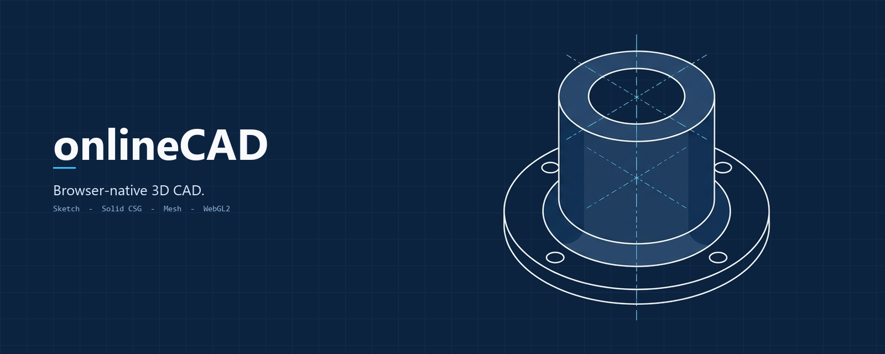
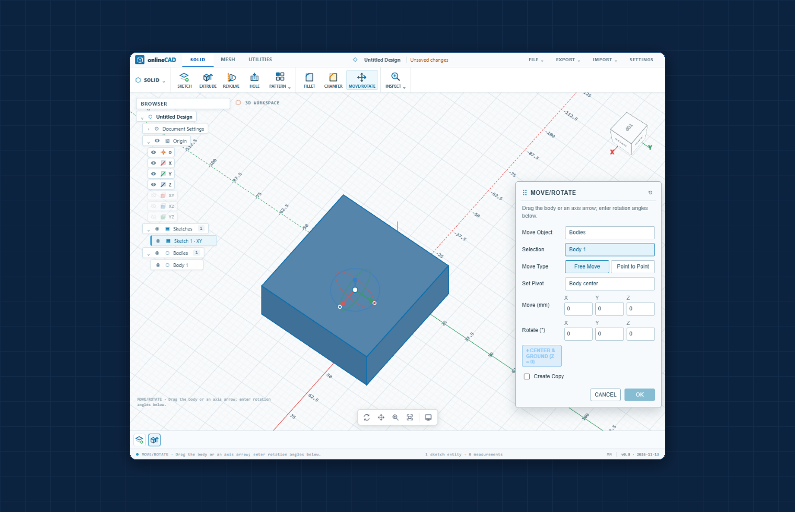
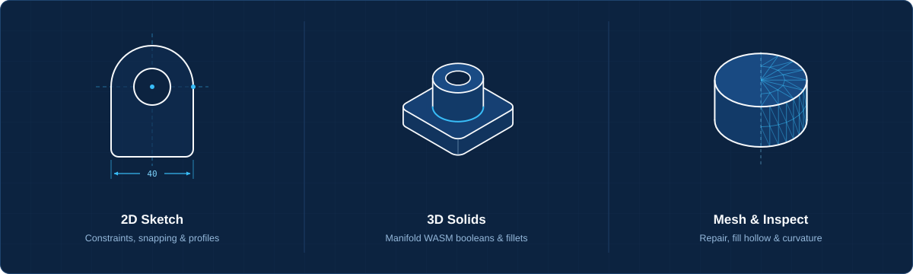
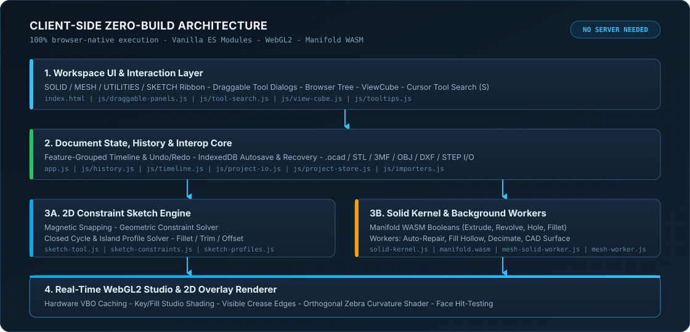

<p align="center">
  
</p>

<h1 align="center">onlineCAD</h1>

<p align="center">
  <strong>Zero-install parametric 2D sketching, Manifold WASM solid modeling, and STL mesh repair in the browser.</strong>
</p>

<p align="center">
  <a href="https://cad.borakosalay.me"><strong>Launch Live App</strong></a>
  &nbsp;-&nbsp;
  <a href="#workspace">Workspace</a>
  &nbsp;-&nbsp;
  <a href="#capabilities">Capabilities</a>
  &nbsp;-&nbsp;
  <a href="#architecture">Architecture</a>
  &nbsp;-&nbsp;
  <a href="#performance">Performance</a>
  &nbsp;-&nbsp;
  <a href="#quick-start">Quick Start</a>
  &nbsp;-&nbsp;
  <a href="#testing">Testing</a>
</p>

---

## Workspace

<p align="center">
  
</p>

- **Clean CAD Workspace**: Tabbed `SOLID`, `MESH`, `UTILITIES`, and `SKETCH` toolbars with unified 24x24 icons, interactive ViewCube, Browser feature tree, and front-layered `XY` / `XZ` / `YZ` origin planes.
- **Draggable Tool Panels**: Every tool dialog (`Extrude`, `Revolve`, `Fillet`, `Chamfer`, `Hole`, `Move/Rotate`, `Pattern`, `Decimate`, `Mesh to Solid`, `Fill Hollow`, `CAD Surface`, `Zebra`, `Interference`) moves freely across the viewport, stays clamped inside bounds, and resets on double-click or via the reset button.
- **Cursor Tool Search (`S`)**: Fuzzy command palette opens next to the pointer for fast keyboard-first modeling.

---

## Capabilities

<p align="center">
  
</p>

- **2D Constraint Sketching**: Sketch on origin planes or planar solid faces (curved walls are excluded automatically). Supports lines, rectangles, center circles, points, construction toggle (`X`), Trim (`T`), Fillet (`F`), Offset (`O`), Mirror, Patterns, live HUD dimensions (`Tab`), constraint relaxation, and nested cycle/island profile solving.
- **Solid 3D Modeling (Manifold WASM)**: `Extrude` (`E`) with Solid/Thin modes and `New` / `Join` / `Cut` / `Intersect` auto-detection, `Revolve` (`V`) 1-360 deg around custom axes, `Hole` (`H`) for Simple/Counterbore/Countersink cuts, edge/circular-rim `Fillet` (`F`) and `Chamfer`, plus `Move/Rotate` (`M`) with 3D gizmo and `Pattern` arrays.
- **Mesh Repair & Analysis**: Welded boundary repair for raw STL/OBJ imports, `Mesh to Solid` analytic primitive fitting, `Fill Hollow` shell closing + cropped voxel flood fill, worker-threaded `Decimate` clustering, non-destructive `CAD Surface` crease smoothing, `Zebra` reflection stripes, and 3D `Interference` clash detection.
- **History & File Interop**: Feature timeline undo/redo (`Ctrl+Z` / `Ctrl+Y`), zero-copy TypedArray IndexedDB autosave with crash recovery, drag-and-drop `STL` / `STEP` / `OBJ` / `DXF` import, and `STL` / `3MF` / `OBJ` / `DXF` / `.ocad` export.

---

## Architecture

<p align="center">
  
</p>

| Layer | Technology | Role |
| :--- | :--- | :--- |
| **Solid Kernel** | [Manifold](https://github.com/elalish/manifold) (`manifold.wasm`) | Watertight CSG booleans, extrusions, revolutions, clash volumes |
| **2D Sketch Engine** | Custom Vanilla JS (`js/sketch-*.js`) | Magnetic snapping, constraint solver, closed-loop profiles |
| **Mesh Workers** | Web Workers + TypedArrays (`js/*-core.js`) | Non-blocking STL/OBJ parsing, repair, Fill Hollow, decimation, BVH checks |
| **3D Renderer** | Custom WebGL2 + GLSL (`js/body-renderer.js`) | Cached VBO shading, crease silhouette lines, Zebra curvature shader |
| **Persistence** | IndexedDB + ES/IIFE Modules | Zero build tooling, TypedArray browser drafts, `.ocad` storage |

---

## Performance

Mesh, voxel, BVH, and autosave hot paths use open-addressed TypedArray hash tables, flat BVH buffers, and zero-copy structured cloning (measured on Node v24 with synthetic 40k-500k triangle benchmarks):

| Operation | Before | After | Speedup |
| :--- | :--- | :--- | :--- |
| Binary STL parse (100k tris) | 118.7 ms | 18.2 ms | 6.5x |
| Grid clustering decimation (100k -> 25k tris) | 201.2 ms | 39.1 ms | 5.1x |
| Surface repair `repairMesh` (100k tris) | 263.3 ms | 43.7 ms | 6.0x |
| Unwelded solid prep `prepareSolidMesh` (100k tris) | 299.5 ms | 96.3 ms | 3.1x |
| CAD surface normals `surfaceFinish.compute` (100k) | 241.9 ms | 76.8 ms | 3.1x |
| Flat BVH deviation `sampledDeviation` (40k tris) | 169.2 ms | 39.6 ms | 4.3x |
| Cropped `Fill Hollow` (`cup`, res=140, gap=32) | 6299.0 ms | 3523.7 ms | 1.8x |
| IndexedDB autosave `serializeProject` (500k tris) | 49.5 ms | 1.5 ms | 33.0x |

---

## Quick Start

Serve the directory over a local HTTP server (required for WebAssembly and Web Workers):

```bash
git clone https://github.com/boraiks/onlineCAD.git
cd onlineCAD
git config core.hooksPath .githooks   # optional version-stamp pre-commit hook
python -m http.server 8080            # or: npx serve .
```

Then open `http://localhost:8080` in any WebGL2 + WASM browser.

---

## Shortcuts

| Key | Action | Context |
| :--- | :--- | :--- |
| `S` | Open Cursor Tool Search | Global |
| `E` / `V` / `H` / `M` | Extrude / Revolve / Hole / Move & Rotate | Solid |
| `F` | 3D Fillet / Sketch Fillet | Solid / Sketch |
| `L` / `R` / `C` | Line / 2-Point Rectangle / Circle | Sketch |
| `T` / `O` / `X` | Trim / Offset / Construction Toggle | Sketch |
| `D` / `A` | Distance / Angle Dimension | Sketch |
| `Home` / `Escape` | Fit View / Cancel Active Tool | Viewport / Global |
| `Ctrl+Z` / `Ctrl+Y` | Undo / Redo | Global |
| `Ctrl+S` / `Ctrl+O` | Save / Open `.ocad` | Global |

---

## Testing

Run the full test suite with Node.js (zero npm install required):

```bash
node --test tests/*.test.mjs
```

All `229` automated tests cover the Manifold solid kernel, 2D constraint and profile solver, STL/OBJ/STEP/DXF/3MF I/O, mesh repair and feature fit, planar face filtering, circular bevel edge generation, draggable dialogs, and optimization invariants.

---

## License

- Application code: [MIT License](LICENSE).
- Bundled [Manifold](https://github.com/elalish/manifold) kernel: Apache License 2.0.
